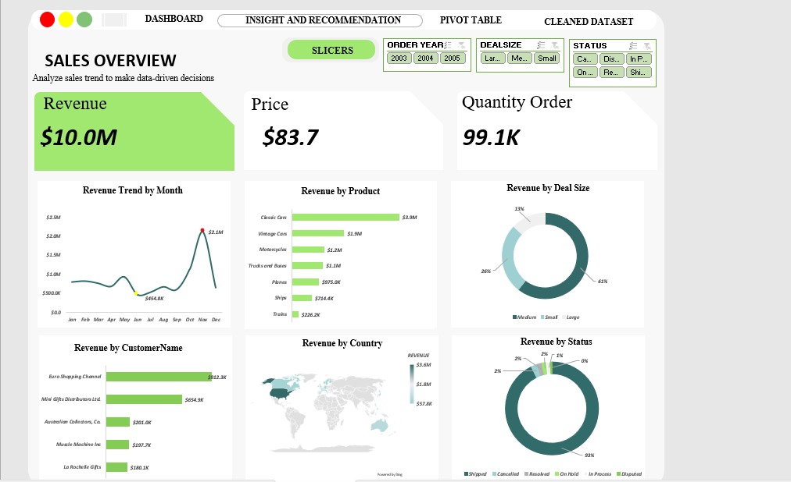

# Sales Performance Analysis and Dashboard Using Microsoft Excel

## Project Overview

This project analyzes historical sales data to examine revenue performance across countries, product lines, deal sizes, customers, order statuses, and time periods. I used Microsoft Excel to prepare the data, create PivotTable summaries, build a sales dashboard, and develop business insights and recommendations.

The analysis covers sales recorded between **January 2003 and May 2005**.

## Dashboard Preview



## Project Objectives

- Measure overall sales performance and quantity ordered.
- Identify the leading countries and product lines by revenue.
- Compare sales across deal sizes and major customers.
- Examine monthly and weekday revenue patterns.
- Review the distribution of sales across order statuses.
- Present findings through an Excel dashboard and actionable recommendations.

## Dataset Overview

| Metric | Value |
|---|---:|
| Sales records | 2,823 |
| Unique order numbers | 307 |
| Quantity ordered | 99,067 units |
| Total recorded sales | $10,032,628.85 |
| Period covered | January 2003 – May 2005 |

The workbook includes order, product, customer, location, deal-size, quantity, sales, and order-status fields.

## Tools and Skills

- **Microsoft Excel** — data preparation, analysis, and dashboard development
- **Excel formulas** — data checks and derived fields
- **PivotTables** — summarizing revenue across business dimensions
- **Charts** — communicating comparisons and trends
- **Business analysis** — interpreting findings and proposing recommendations

## Project Workflow

### 1. Data Review and Preparation

I retained the original dataset in a separate worksheet and worked with a cleaned dataset for analysis. Date-related fields were prepared to support monthly and weekday comparisons.

**Data-quality note:** Missing `STATE` values were filled using the most frequently occurring state across the full dataset (global mode imputation). Because the records span multiple countries, this approach can produce geographically inaccurate assignments. Some `TERRITORY` values remain missing. These issues are acknowledged as limitations, and state-level conclusions should be treated cautiously.

### 2. Sales Analysis

I used PivotTables to explore revenue by country, product line, deal size, customer, month, weekday, and order status.

### 3. Dashboard Development

I created an Excel dashboard with five charts to summarize the main sales comparisons and patterns.

### 4. Business Insights

I interpreted the dashboard results and developed recommendations related to market concentration, product performance, deal sizes, customer relationships, sales planning, and order monitoring.

## Key Findings

| Analysis area | Finding |
|---|---|
| Overall revenue | Approximately **$10.0 million** |
| Leading country | **United States**, approximately **$3.6 million** |
| Other leading countries | **Spain** (~$1.2M) and **France** (~$1.1M) |
| Leading product line | **Classic Cars**, approximately **$3.9 million** |
| Second-leading product line | **Vintage Cars**, approximately **$1.9 million** |
| Highest-revenue deal size | **Medium**, approximately **$6.1 million** |
| Highest-revenue month in the aggregated analysis | **November**, approximately **$2.1 million** |
| Highest-revenue weekday | **Friday**, approximately **$2.1 million** |

**Customer performance:** Euro Shopping Channel and Mini Gifts Distributors Ltd. were among the leading customers by revenue. These are customer names in the dataset, not necessarily distinct sales channels.

**Order status:** Most recorded sales revenue is associated with orders marked as shipped. This describes order-status distribution but does not, on its own, prove operational efficiency or customer satisfaction.

## Business Recommendations

1. **Diversify geographic revenue:** Maintain relationships in strong markets while testing targeted growth initiatives in other countries.
2. **Support key product lines:** Prioritize effective inventory and marketing for Classic Cars and Vintage Cars, while reviewing opportunities in other product lines.
3. **Explore larger deals:** Evaluate volume incentives and corporate sales opportunities to increase revenue from large transactions.
4. **Plan around observed sales patterns:** Use the stronger November performance to inform planning, while comparing individual years before concluding that demand is seasonal.
5. **Review weekday differences:** Investigate whether targeted weekend initiatives could improve sales.
6. **Broaden the customer base:** Maintain major customer relationships while reducing reliance on a few high-revenue accounts.
7. **Monitor order exceptions:** Review cancelled, disputed, on-hold, and in-process orders to identify potential improvements.

## Limitations

- The dataset is historical; results should not be presented as current business performance.
- Global mode imputation of `STATE` may distort detailed geographic analysis.
- Some `TERRITORY` entries remain missing.
- Monthly and weekday patterns show associations, not the causes of sales changes.
- Revenue is not profit; cost and margin information was not included.
- The analysis identifies major **customers**, not verified distribution channels.

## Repository Structure

```text
sales-performance-excel-dashboard/
├── README.md
├── SALES DATASET.xlsx
└── images/
    └── dashboard.png
```

The Excel workbook contains the original dataset, cleaned dataset, PivotTables, dashboard, and insights/recommendations.

## Conclusion

This project demonstrates my ability to prepare and analyze business data in Excel, build a dashboard, interpret sales patterns, and communicate recommendations while acknowledging data-quality and analytical limitations.
